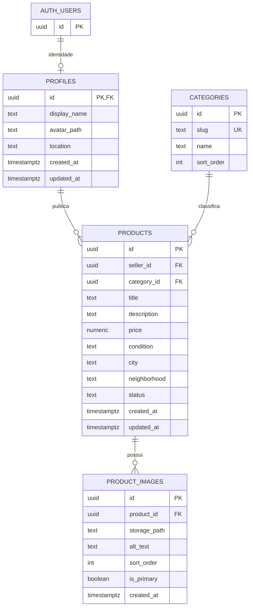

# Ver-o-Preço

Marketplace regional para aproximar quem quer vender de quem procura produtos usados por perto, começando pelo Pará. A plataforma permite descobrir anúncios por categoria e localização e negociar diretamente, sem expor os dados pessoais do vendedor no anúncio.

O Ver-o-Preço foi pensado para pessoas que vendem de forma ocasional, pelo celular, e para compradores que querem encontrar boas opções na própria cidade. A venda é combinada entre as pessoas: o produto não processa pagamentos nem oferece entrega ou custódia.

## Objetivos do projeto

- Facilitar a compra e venda local em Belém, Ananindeua, Marituba, Castanhal, Santarém e outros municípios do Pará.
- Permitir que vendedores publiquem seus produtos sem comissão sobre a venda.
- Manter a navegação pública simples e reservar ações da conta para usuários autenticados.
- Oferecer uma experiência mobile-first, acessível, segura e em português brasileiro.
- Evoluir em módulos independentes, com autorização aplicada no servidor e no Supabase.

## Estado do produto

**Disponível ou em desenvolvimento**

- Catálogo público com busca, categorias, filtros, ordenação e paginação.
- Páginas de produto e perfis públicos de vendedores.
- Cadastro, login, logout e recuperação de senha.
- Perfil com nome, avatar, telefone e localização.
- Criação, edição, publicação, pausa e exclusão dos próprios anúncios, incluindo upload e organização de imagens.
- Ações para favoritar e remover favoritos.
- Área autenticada e dashboard inicial.

**Próximas entregas do MVP**

- Conversas entre compradores e vendedores vinculadas a um anúncio, com mensagens, imagens e recursos em tempo real.
- Página para consultar favoritos e dashboard completo.

Consulte [PRODUCT.md](./PRODUCT.md) para o escopo e as decisões de produto e [docs/plans/](./docs/plans/) e [.opencode/plans/](./.opencode/plans/) para os planos de implementação.

## Tecnologias

- [Next.js](https://nextjs.org/) 16 com App Router e React 19.
- TypeScript e Tailwind CSS 4.
- Primitivas de interface compatíveis com shadcn/ui, Radix UI e ícones Lucide.
- Supabase Auth, PostgreSQL, Storage e Realtime, com Row Level Security (RLS).
- Vitest e Testing Library para testes.
- Bun para instalação de dependências e execução dos scripts.

## Começando

### Pré-requisitos

- [Bun](https://bun.sh/) instalado.
- Um projeto Supabase para autenticação, banco de dados e armazenamento.

### Instalação

1. Clone o repositório e entre na pasta do projeto.
2. Instale as dependências:

   ```bash
   bun install
   ```

3. Crie o arquivo local de ambiente:

   ```bash
   cp .env.example .env.local
   ```

4. Preencha em `.env.local` as credenciais do seu projeto Supabase:

   ```dotenv
   NEXT_PUBLIC_SUPABASE_URL=https://seu-projeto.supabase.co
   NEXT_PUBLIC_SUPABASE_ANON_KEY=sua-chave-publica
   NEXT_PUBLIC_SITE_URL=http://localhost:3000
   ```

   `NEXT_PUBLIC_SITE_URL` é opcional em desenvolvimento. Configure também a URL do site e o redirect `/auth/callback` em **Supabase → Authentication → URL Configuration**, conforme [a documentação de arquitetura do Supabase](./docs/architecture/supabase.md).

5. Consulte a seção [Banco de dados e migrations](#banco-de-dados-e-migrations) antes de aplicar os scripts SQL. Para dados de demonstração, avalie o seed em [`seeds/`](./seeds/).
6. Inicie o servidor:

   ```bash
   bun run dev
   ```

7. Abra [http://localhost:3000](http://localhost:3000).

Não use credenciais reais no código ou em arquivos versionados. A chave `SUPABASE_SERVICE_ROLE_KEY` nunca deve ser exposta ao navegador.

## Comandos

```bash
bun run dev        # servidor de desenvolvimento
bun run typecheck  # verificação de tipos TypeScript
bun run lint       # lint
bun run test       # testes
bun run build      # build de produção
bun run start      # servidor de produção local
```

## Organização do código

O projeto segue uma arquitetura **feature-first**. Regras e componentes de domínio ficam no próprio módulo; código compartilhado deve ser extraído somente quando realmente servir a mais de uma feature.

```text
src/
├── app/                 # rotas e layouts do Next.js
├── components/
│   ├── layout/          # estrutura compartilhada da aplicação
│   └── ui/              # primitivas reutilizáveis
├── features/
│   ├── auth/
│   ├── favorites/
│   ├── landing/
│   ├── listings/
│   ├── products/
│   └── profile/
└── lib/supabase/        # clientes Supabase de servidor e navegador

migrations/              # alterações versionadas no banco
seeds/                   # dados de demonstração
docs/                    # arquitetura, design e planos
```

Prefira Server Components. Use Client Components quando houver necessidade de interação, estado local ou APIs do navegador. Consultas e regras de negócio devem permanecer nos módulos de feature, não em componentes compartilhados.

## Documentação

A pasta [`docs/`](./docs/) reúne referências complementares para entender e desenvolver o projeto:

- [`docs/architecture/`](./docs/architecture/): visão geral da arquitetura, limites e responsabilidades dos módulos, integração com Supabase e fluxo de anúncios.
- [`docs/design/`](./docs/design/): referência de componentes e dos tokens e princípios visuais.
- [`docs/plans/`](./docs/plans/): planos de fundação, autenticação e fluxos de interface já documentados.

Leia também o [PRODUCT.md](./PRODUCT.md) para contexto, escopo e decisões de produto, o [AGENTS.md](./AGENTS.md) para padrões de desenvolvimento e o [DESIGN.md](./DESIGN.md) como fonte de verdade visual. Os arquivos em [`.opencode/plans/`](./.opencode/plans/) registram planos adicionais de features.

## Banco de dados e migrations

A pasta [`migrations/`](./migrations/) contém scripts SQL versionados que descrevem e alteram o schema do Supabase. **A modelagem ainda está em desenvolvimento: ela está sendo construída e preenchida gradualmente conforme as funcionalidades avançam e não deve ser considerada finalizada ou imutável.** Novas migrations e ajustes podem ser necessários; confira a documentação e o estado do ambiente Supabase antes de aplicar mudanças.

Migrations atualmente presentes:

- `0001_init.sql`: placeholder inicial para a evolução do schema.
- `0002_profiles.sql`: tabela de perfis, políticas de Row Level Security e atualização de `updated_at`.
- `0003_products.sql`: categorias, produtos e imagens, status do anúncio, índices e políticas de acesso; inclui suporte a busca parcial com `pg_trgm`.
- `0004_listing_images.sql`: função RPC para substituir atomicamente as imagens de um anúncio com validação de propriedade.

Esses arquivos são **modelagem e lógica de banco**, não dados de catálogo. Os dados de demonstração ficam separados em [`seeds/`](./seeds/). Os scripts indicam como podem ser aplicados; mantenha a ordem numérica e valide o ambiente de destino e o estado atual do schema para evitar reaplicações ou divergências.

### Diagrama atual

Este diagrama representa as tabelas persistentes definidas pelas migrations até `0004`. `auth.users` é gerenciada pelo Supabase; o relacionamento com `profiles` é um-para-um. O bucket de imagens é Supabase Storage, não uma tabela relacional:



`products.status` pode ser `draft`, `active`, `paused`, `sold` ou `removed`; apenas anúncios `active` são visíveis publicamente, enquanto o vendedor pode consultar e administrar os próprios anúncios. As imagens ficam no bucket `product-images`, e `storage_path` aponta para o arquivo correspondente. A migration também define a view `category_listing_counts`, que resume anúncios ativos por categoria.

Favoritos, conversas e mensagens aparecem na arquitetura e nos planos do produto, mas ainda não são tabelas criadas por estas migrations. O diagrama descreve o schema atual, não o modelo futuro completo.

## Como contribuir

1. Confira o [PRODUCT.md](./PRODUCT.md), o [AGENTS.md](./AGENTS.md), o [DESIGN.md](./DESIGN.md) e a documentação da feature antes de começar.
2. Para uma mudança maior, consulte ou atualize um plano em [`docs/plans/`](./docs/plans/) ou [`.opencode/plans/`](./.opencode/plans/).
3. Crie uma branch a partir de `develop`, com um nome claro, por exemplo `feat/listing-images` ou `fix/profile-validation`.
4. Mantenha a mudança focada no domínio correspondente e siga os padrões de responsividade, acessibilidade, validação e estados de carregamento, vazio e erro.
5. Para mudanças de banco, adicione uma migration. Revise RLS e políticas de Storage; não dependa apenas da autorização no cliente.
6. Execute as verificações relevantes antes de abrir o pull request:

   ```bash
   bun run typecheck
   bun run lint
   bun run test
   bun run build
   ```

7. Abra um pull request para `develop`, explicando o problema, a solução, mudanças de banco e como validar. Inclua capturas de tela quando a interface mudar.

Use mensagens de commit descritivas no formato Conventional Commits, por exemplo:

```text
feat(listings): add image reordering
fix(auth): handle expired recovery links
docs(readme): document local setup
```

## Deploy

O projeto pode ser hospedado na [Vercel](https://vercel.com/). Configure as variáveis Supabase do ambiente de destino e as URLs de autenticação correspondentes no painel do Supabase antes de disponibilizar o deploy.
