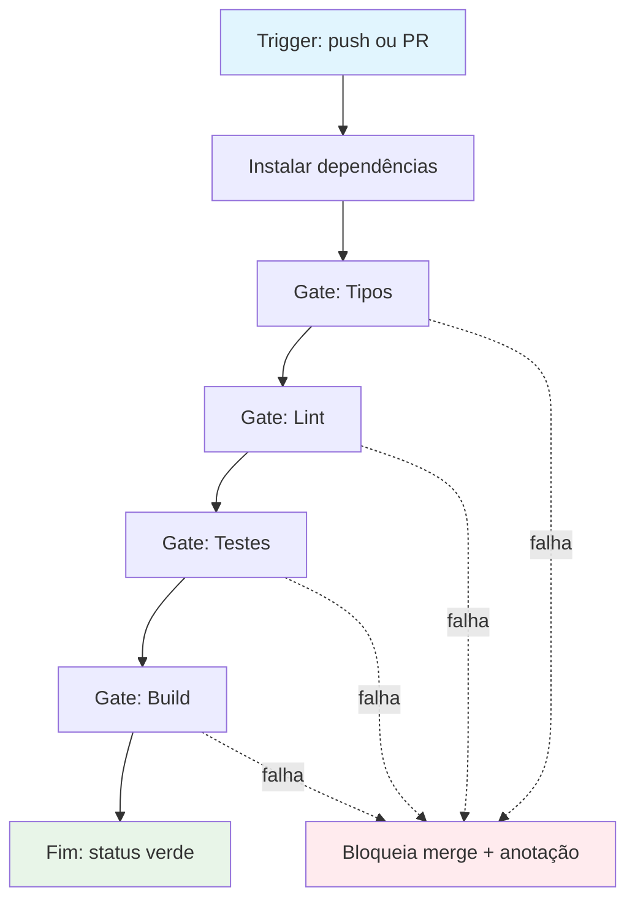

## Workflow Overview

**Purpose**: Garantir, de forma automatizada, que cada mudança atende aos gates de qualidade do projeto antes de integrar `main`/`develop`.
**Trigger Events**: Push em `main`/`develop`; pull request aberto ou atualizado mirando `main`/`develop`.
**Target Environments**: Nenhum ambiente de execução — CI apenas (sem deploy).

## Execution Flow Diagram



## Jobs & Dependencies

| Job | Propósito                                | Dependências | Contexto de Execução                              |
| --- | ---------------------------------------- | ------------ | ------------------------------------------------- |
| ci  | Executar gates de qualidade em sequência | Nenhuma      | Runner Linux, runtime do projeto na versão fixada |

Sub-gates do job `ci`, em ordem (falha rápida no primeiro erro):

1. Instalar dependências a partir do lockfile
2. Verificação de tipos
3. Lint
4. Suite de testes
5. Build de produção

## Requirements Matrix

### Functional Requirements

| ID      | Requisito                                                           | Prioridade | Critério de Aceite                         |
| ------- | ------------------------------------------------------------------- | ---------- | ------------------------------------------ |
| REQ-001 | Executar em push para `main`/`develop` e em PRs para essas branches | Alta       | Workflow visível em ambas as situações     |
| REQ-002 | Verificação de tipos sem erros                                      | Alta       | Saída do gate de tipos vazia               |
| REQ-003 | Lint sem erros                                                      | Alta       | 0 erros (warnings não bloqueiam)           |
| REQ-004 | Todos os testes automatizados passam                                | Alta       | 0 falhas na suite                          |
| REQ-005 | Build de produção gera artefato com sucesso                         | Alta       | Build conclui sem erro                     |
| REQ-006 | Instalação reproduzível via lockfile congelado                      | Alta       | Instalação falha se lockfile desatualizado |
| REQ-007 | Falha rápida: gates sequenciais, sem executar o seguinte após falha | Média      | Primeiro gate com falha encerra o job      |

### Security Requirements

| ID      | Requisito                 | Restrição de Implementação                                         |
| ------- | ------------------------- | ------------------------------------------------------------------ |
| SEC-001 | Menor privilégio          | Permissão do token restrita a leitura do conteúdo                  |
| SEC-002 | Segredos mínimos com fallback | Somente variáveis públicas do Supabase via GitHub Secrets; PRs sem secrets usam placeholders públicos |
| SEC-003 | Cadeia de suprimentos     | Instalação obriga lockfile congelado; ações em versões major fixas |
| SEC-004 | Sem exposição de chaves   | Chaves de serviço/serviço role nunca presentes no workflow         |

### Performance Requirements

| ID       | Métrica                       | Alvo                           | Medição                    |
| -------- | ----------------------------- | ------------------------------ | -------------------------- |
| PERF-001 | Duração total do workflow     | ≤ 10 min                       | Dashboard do Actions       |
| PERF-002 | Taxa de cache de dependências | > 90% após 1ª execução         | Hit rate do cache          |
| PERF-003 | Sem execução redundante       | Gates não repetidos após falha | Ordem sequencial observada |

## Input/Output Contracts

### Inputs

```yaml
# Variáveis de Ambiente (públicas; valores vêm de GitHub Secrets)
NEXT_PUBLIC_SUPABASE_URL: string # Propósito: URL do projeto Supabase usada na validação de env e no build
NEXT_PUBLIC_SUPABASE_PUBLISHABLE_KEY: string # Propósito: chave publicável do Supabase (nunca a service role)
NEXT_PUBLIC_SITE_URL: string # Propósito: URL pública usada em links de autenticação (opcional)

# Fallback: quando o secret não está disponível (PR de fork/Dependabot),
# a variável assume um valor placeholder público e o build segue determinístico.

# Triggers
branches: [main, develop]
paths: [todos] # Sem filtro de caminhos
```

### Outputs

```yaml
# Status do job
ci_status: check | x # Descrição: resultado visível no PR
build_artifact: none # Descrição: artefato não persistido (CI apenas)
```

### Secrets & Variables

| Tipo          | Nome                                    | Propósito                                                           | Escopo                      |
| ------------- | --------------------------------------- | ------------------------------------------------------------------- | --------------------------- |
| GitHub Secret | `NEXT_PUBLIC_SUPABASE_URL`              | URL do projeto Supabase, espelhando o valor configurado na Vercel   | Actions / repositório       |
| GitHub Secret | `NEXT_PUBLIC_SUPABASE_PUBLISHABLE_KEY`  | Chave publicável do Supabase (pública por design)                   | Actions / repositório       |
| GitHub Secret | `NEXT_PUBLIC_SITE_URL`                  | URL pública para links de autenticação; opcional                    | Actions / repositório       |

Nenhum secret de servidor (ex.: service role, `DATABASE_URL`) é referenciado. Secrets não são expostos a PRs de fork; nesse caso os placeholders assumem.

## Execution Constraints

### Runtime Constraints

- **Timeout**: padrão do runner; alvo operacional ≤ 15 min
- **Concorrência**: não configurada (gap futuro: cancelar runs supersedidos)
- **Recursos**: runner Linux padrão

### Environmental Constraints

- **Runner**: Linux, último da plataforma
- **Rede**: acesso ao registry público de pacotes para instalar dependências
- **Permissões**: `contents: read` apenas

## Error Handling Strategy

| Tipo de Erro                              | Resposta                               | Ação de Recuperação                                   |
| ----------------------------------------- | -------------------------------------- | ----------------------------------------------------- |
| Falha em gate                             | Job falha, PR anotado, merge bloqueado | Corrigir causa localmente, reenviar                   |
| Instalação falha (lockfile desatualizado) | Falha no primeiro passo                | Regenerar lockfile e cometer                          |
| Cache ausente/corrompido                  | Install completo (cold)                | Próximo run restaura cache                            |
| Teste instável (flaky)                    | Falha intermitente                     | Re-run; se recorrente, tratar como bug                |
| Placeholder de env insuficiente           | Falha fechada do serviço               | Revisar se build passou a depender de credencial real |

## Quality Gates

### Gate Definitions

| Gate   | Critério                       | Condição de Bypass |
| ------ | ------------------------------ | ------------------ |
| Tipos  | Compilação sem erros           | Nenhuma            |
| Lint   | 0 erros                        | Nenhuma            |
| Testes | 100% dos testes passam         | Nenhuma            |
| Build  | Build de produção bem-sucedido | Nenhuma            |

## Monitoring & Observability

### Métricas-chave

- **Taxa de sucesso**: alvo > 95% (runs verdes / total)
- **Tempo de execução**: alvo ≤ 10 min
- **Uso de cache**: hit rate do cache de dependências

### Alertas

| Condição                  | Severidade | Alvo                                 |
| ------------------------- | ---------- | ------------------------------------ |
| CI falhando em `main`     | Alta       | Autor do merge via check obrigatório |
| Tempo > 15 min recorrente | Baixa      | Manutenção do workflow               |

## Integration Points

### Sistemas Externos

| Sistema             | Tipo    | Troca                     | SLA                     |
| ------------------- | ------- | ------------------------- | ----------------------- |
| Registry de pacotes | Install | Download por lockfile     | Disponibilidade pública |
| Cache da plataforma | Cache   | Armazenar/restore de deps | Best-effort             |

### Workflows Dependentes

| Workflow | Relação       | Trigger                       |
| -------- | ------------- | ----------------------------- |
| —        | Futuro deploy | Este workflow é pré-requisito |

## Compliance & Governance

### Auditoria

- **Logs**: retenção padrão da plataforma (90 dias)
- **Aprovações**: check obrigatório antes do merge (configurar branch protection)
- **Mudança**: spec first (ver Change Management)

### Controles de Segurança

- **Acesso**: token somente leitura
- **Segredos**: nenhum; placeholders apenas
- **Varredura**: fora do escopo deste workflow (futuro: scan de dependências)

## Edge Cases & Exceptions

| Cenário                | Comportamento Esperado                           | Validação                    |
| ---------------------- | ------------------------------------------------ | ---------------------------- |
| Lockfile desatualizado | Install falha; CI bloqueia                       | Forçar divergência local     |
| Env pública ausente    | PR de fork/Dependabot sem secrets cai em placeholders; serviços falham fechados | Rodar gate com secrets vazios |
| Teste instável         | Falha intermitente; re-run resolve               | Re-run do run falho          |
| Runner sem rede        | Instalação falha                                 | Observar erro de rede        |

## Validation Criteria

### Workflow Validation

- **VLD-001**: Gates executam na ordem tipos → lint → testes → build
- **VLD-002**: Build passa com os secrets configurados e também com placeholders (PRs sem secrets)
- **VLD-003**: Somente variáveis públicas são referenciadas; nenhum secret de servidor aparece no workflow
- **VLD-004**: Falha em qualquer gate bloqueia os subsequentes

### Performance Benchmarks

- **PERF-001**: Run completo < 10 min em runner Linux padrão
- **PERF-002**: Segundo run consecutivo usa cache (install < 30s)

## Change Management

### Processo de Atualização

1. **Spec**: atualizar este documento primeiro
2. **Revisão**: aprovação da equipe de engenharia
3. **Implementação**: aplicar mudança no workflow
4. **Teste**: validar gates localmente na mesma ordem
5. **Implantação**: merge na branch protegida

### Histórico de Versões

| Versão | Data       | Mudanças                                                                 | Autor      |
| ------ | ---------- | ------------------------------------------------------------------------ | ---------- |
| 1.0    | 2026-11-14 | Especificação inicial do workflow de CI                                  | Engenharia |
| 1.1    | 2026-11-14 | Variáveis do Supabase passam a vir de GitHub Secrets, com fallback para PRs sem secrets | Engenharia |

## Related Specifications

- `docs/codebase-audit/20-roadmap.md` — matriz de dependências e prioridades
- `AGENTS.md` — gates de qualidade (`typecheck`, `lint`, `test`, `build`)
- `docs/agents/issue-tracker.md` — convenções do issue tracker (GitHub)
- `.github/workflows/ci.yml` — implementação desta spec
